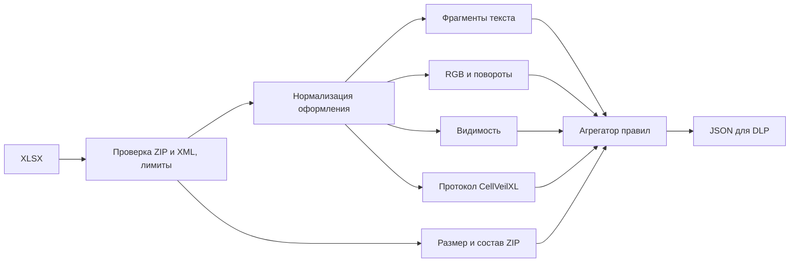

# Детектор скрытых данных в XLSX

Модуль анализирует семейство каналов, которые используют оформление Excel. Он возвращает признаки и оценку риска для внешней DLP. Сам модуль ничего не блокирует и не отправляет: решение остаётся за политикой организации.

Это прототип для пилота, а не готовый коннектор к конкретному DLP-продукту. Он не расшифровывает данные и не определяет их конфиденциальность. Общая аномалия оформления сама по себе не доказывает утечку или использование CellVeilXL.

## Запуск

Нужен Python 3.10+. Выполняйте команды из корня проекта:

```powershell
python -m pip install -r dlp/requirements.txt
python -m dlp document.xlsx
```

JSON выводится в stdout. Коды завершения: `0` — риск ниже порога, `1` — порог достигнут, `2` — ошибка или превышение лимита. Порог по умолчанию — 60. Excel и ключи шифрования не нужны. Входной файл не изменяется.

Для интеграции:

```python
from dlp import Limits, Policy, analyze_xlsx

report = analyze_xlsx(
    "document.xlsx",
    limits=Limits(file_bytes=10 * 1024 * 1024),
    policy=Policy(alert_score=65),
)
```

Сначала проверяйте `status`. При `error` или `limit_exceeded` результат всегда `inconclusive`: DLP должна применить политику непроверенных файлов. При `ok` можно учитывать `risk_score`, отдельные профили и правила. Для пилота разумно начать с регистрации событий и ручной проверки; автоматический карантин включать после настройки на документах организации.

## Архитектура



Общие анализаторы получают нормализованные измерения ячейки без её текста. Они не зависят от набора шрифтов CellVeilXL. Протокольный анализатор отдельно восстанавливает конкретный порядок битов. Это позволяет добавлять правила для других каналов, сохраняя общий формат отчёта.

| Блок | Что измеряет | Как используется |
|---|---|---|
| `package.py` | Размер ZIP, распакованный объём, медиа, вложенные объекты, объём значений | Слабый сигнал несоответствия размера содержимому; сжатые медиа исключаются из числителя |
| `formatting.py` | Долю rich text, долю текста во фрагментах длиной 1–2 UTF-16 единицы, распределение шрифтов | Поиск массового дробления текста; обычное выделение длинных фраз не считается посимвольным |
| `color.py` | RGB-покрытие, гистограммы и энтропию 1, 2 и 3 младших битов отдельно R, G, B и совместно RGB | Поиск разнообразных младших битов при почти неизменных старших битах внутри ячейки |
| `rotation.py` | Распределение углов, концентрацию в узких диапазонах, разнообразие младших битов | Поиск небольших вариаций наклона с достаточным числом наблюдений |
| `visibility.py` | Текст в скрытых листах, строках, колонках и с форматом `;;;` | Контекст для проверки; штатное скрытие само по себе имеет низкий вес |
| `cellveilxl.py` | Заголовок, режим, версию, длину, чётность UTF-16, ограничения открытого ключа и доступные биты | Сильный сигнал конкретного формата, включая произвольную четырёхбайтовую метку |

Первые три цветовые модели и несколько моделей наклона относятся к одной семье признаков каждая. Их срабатывания не суммируются. Метрики остаются в отчёте даже при отсутствии тревоги.

Размер «видимого содержимого» — оценка по UTF-8 представлению значений в нескрытых ячейках, а не результат рендеринга. Формулы без вычисления не дают достоверного отображаемого значения и учитываются отдельно как `formula_cells_unmeasured`. Числовые форматы, изображения и особенности отображения ограничивают точность этой оценки. Поэтому размер не может самостоятельно вызвать тревогу.

## Оценки и доказательства

В `profiles` возвращаются две независимые оценки:

- `formatting_steganography.risk_score` — общие признаки скрытия в оформлении;
- `cellveilxl.risk_score` — признаки формата CellVeilXL. Поле `generic_support_score` показывает общий контекст, не приписывая аномалию этому инструменту.

Итоговый `risk_score` — максимум оценок профилей. Это **балл правил, не вероятность**. Пороговые значения заданы явно в `Policy`; отчёт содержит применённую политику, лимиты, версии схемы и детектора, SHA-256 и длительность проверки `duration_ms`. Для файла, который нельзя прочитать в пределах лимита, SHA-256 может отсутствовать.

| Правило | Балл по умолчанию |
|---|---:|
| Полная структура CellVeilXL с `CVX3` | 95 |
| Полная структура с изменённой меткой | 85 |
| Известная сигнатура, но неполная или повреждённая структура | 70 |
| Цветовая аномалия в нескольких ячейках / одной ячейке | 50 / 30 |
| Дробление текста в нескольких ячейках / одной ячейке | 45 / 25 |
| Аномалия поворотов | 35 |
| Большой объём относительно значений | 25 |
| Скрытый текст | 15 |

Для общего профиля берётся самый сильный сигнал. За каждую дополнительную семью с баллом от 35 добавляется 10, максимум 20 дополнительных баллов; общий потолок — 80. Например, цвет 50 и дробление 45 дают 60, а не 95. Повторения одного правила и срабатывания на разных глубинах битов не увеличивают балл. Такая схема ограничивает повторный учёт связанных признаков, но не превращает их в статистически независимые доказательства.

Значения `verdict`: `no_indicators` при нуле, `review` ниже порога, `suspicious` от порога до 84, `high_risk` от 85. Ошибки проверки переопределяют вердикт в `inconclusive`.

`findings` содержит правила, их баллы, листы и адреса примеров. Для протокола также возвращаются метка, режим, размер и выполненные проверки. `complete` означает достаточное количество битов и согласованность структуры, а не успешную расшифровку или проверку целостности. Текст ячеек и извлечённые байты в отчёт не включаются; имена листов присутствуют как контекст события.

## Покрытие и безопасность обработки

Проверяются все листы, включая скрытые. Общие анализаторы рассматривают все непустые текстовые ячейки; настройки `HOST_RANGE` относятся только к восстановлению протокола. При известном диапазоне передайте `--range B2:D100` или `host_range="B2:D100"` в API.

`coverage` показывает покрытие протокольного декодера, а `features` — измерения общих анализаторов по каждому листу и всему пакету. RGB-покрытие указывается отдельно: цвета темы и индексированные цвета не преобразуются в RGB. Шрифты, углы и разбиение текста при этом всё равно анализируются.

По умолчанию допускаются 20 MiB входных данных, 64 MiB распакованных данных, 2000 ZIP-записей, 100 листов, 200000 записанных ячеек и 2 млн UTF-16 единиц анализируемого текста. Объявленная область листа или отдельное объединение ограничены 500000 ячеек; суммарный объём объединений — 200000. Максимум находок — 100. Пределы задаёт `Limits`.

Файл читается в ограниченный буфер, а проверка ZIP и XML выполняется до загрузки книги. Дубликаты ZIP-записей, шифрованный ZIP, DTD и XML-сущности отклоняются. Архив не распаковывается на диск. Макросы, внешние ссылки и формулы не исполняются. Для rich text используется [openpyxl](https://openpyxl.readthedocs.io/en/3.1/rich_text.html), для XML — рекомендованный авторами [defusedxml](https://pypi.org/project/openpyxl/). Версии зависимостей зафиксированы; обход только записанных ячеек использует внутреннюю коллекцию openpyxl, чтобы не разворачивать разреженный лист в огромный прямоугольник. При обновлении библиотеки этот участок нужно проверять тестами совместимости.

Для промышленной DLP нужен отдельный рабочий процесс с лимитами памяти, времени, параллельности и очереди, заданными интегратором. Библиотечные лимиты не заменяют ограничения процесса. Зависимости также нужно фиксировать и проверять по правилам организации.

## Проверки и демонстрация

```powershell
python -m unittest discover -s dlp -p "test_*.py" -v
python -m dlp.demo --output .test-output/dlp-demo
```

Демонстрация создаёт XLSX, JSON-отчёты и `report.html` для просмотра без сервера и сетевых ресурсов. В ней есть обычный файл, синтетические пакеты с двумя метками, похожий канал без заголовка и с посторонним шрифтом, а также нечитаемый файл. Синтетические пакеты содержат тестовые байты и не выдаются за реальное шифрование. Дополнительные образцы, созданные Excel/VBA, можно передать через `--include file1.xlsx file2.xlsx`.

Автотесты проверяют анализаторы отдельно, агрегатор, оба режима протокола, изменённые метки, отрицательные углы, скрытые листы, shared strings и inline strings, обычное оформление, повреждение входа, XML-сущности, лимиты и коды CLI. Дополнительно выполнена проверка четырёх файлов, созданных VBA: оба режима с исходной и изменённой меткой обнаружены. Проверка 20 сгенерированных обычных документов не дала срабатываний. Это результат на тестовых примерах, а не оценка промышленной точности.

## Что проверять на пилоте

Начните с размеченной выборки реальных документов разных подразделений: отчёты, выгрузки, презентационные таблицы, файлы с рисунками, большим количеством стилей и законным скрытием листов. Добавьте носители известных и изменённых алгоритмов, включая повреждённые экземпляры.

Разделите данные для настройки и итоговой проверки. Измеряйте долю ложных тревог, обнаружение каждого типа носителей, долю непроверенных файлов, время и потребление памяти. Фиксируйте версии политики и корпуса, не помещая конфиденциальные данные в журнал. До такой проверки нельзя обоснованно обещать процент обнаружения или рекомендовать безусловную блокировку.

Изменённый порядок обхода ячеек, нестандартный диапазон, другие каналы, редкие короткие сообщения и повреждённое оформление могут мешать обнаружению. Обычные градиенты, rich text и специальные наклоны могут давать похожие признаки. Модуль покрывает семейство способов скрытия в оформлении XLSX, а не все возможные обходы DLP.
